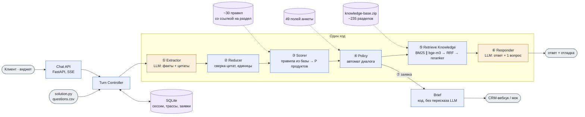

# Energytool — ИИ-консультант-квалификатор

Чат-ассистент для сайта МТС Energytool. Понимает задачу клиента, отвечает только по базе знаний, подбирает продукты (оптовый рынок, платформа учёта, солнечные станции, поиск потерь, распознавание показаний), по ходу заполняет опросный лист и передаёт менеджеру заявку с готовым брифом.

Одно ядро работает в двух режимах: веб-чат с виджетом и консолью мониторинга (этап 2) и батч `solution.py` для автосабмита (этап 1, **64.1** на платформе).

- [Запуск](#запуск)
- [Что попробовать](#что-попробовать)
- [Подход](#подход)
- [Где что лежит](#где-что-лежит)
- [Эксперименты и результаты](#эксперименты-и-результаты)
- [Справочник: API, переменные, разработка](#справочник)

## Запуск

Нужно:

- ключ [OpenRouter](https://openrouter.ai) (через него доступны все три модели: `qwen/qwen3.8-27b`, `baai/bge-m3`, `qwen/qwen3-reranker-8b`) или OpenAI-совместимый прокси организаторов;
- `knowledge-base.zip` — база знаний хакатона (выдают организаторы, в репозиторий не входит);
- Docker с compose **или** [uv](https://docs.astral.sh/uv/) и Python 3.11.

### Docker

```bash
cp .env.example .env                           # вписать LLM_API_KEY
mkdir -p data && cp /путь/к/knowledge-base.zip data/
docker compose up --build                      # http://localhost:8000
```

Сервис готов, когда `GET /healthz` отвечает (старт ~15 с: индексация базы и эмбеддинги). База монтируется томом `./data` только для чтения, сессии и заявки лежат в томе `energytool-var` (SQLite + файлы `leads/lead-<id>.txt`).

### Без Docker

```bash
cp .env.example .env                           # вписать LLM_API_KEY
mkdir -p data && cp /путь/к/knowledge-base.zip data/
uv sync --extra web
uv run --env-file .env python -m energytool ping   # проверить chat, embeddings, rerank
uv run --env-file .env uvicorn energytool.interface.http.app:create_app --factory --port 8000
```

### Адреса

| Адрес | Что там |
|---|---|
| `http://localhost:8000/` | консоль: чат-консультант (кнопка «Чат-бот» справа внизу), форма заявки, «Мониторинг» с трассами ходов и вкладкой «Заявки» |
| `/widget-demo` | демо-страница встраиваемого виджета `/widget.js` |
| `/leads` | заявки с брифами для менеджера |
| `/docs` | OpenAPI |

## Что попробовать

Основной сценарий — от вопроса до заявки:

1. Откройте `/`, нажмите «Начать консультацию» и откройте «Мониторинг» слева сверху.
2. «У нас хлебозавод, счета за свет выросли на треть» — бот ответит по базе и спросит мощность. В мониторинге видны время по шагам, документы базы, переход автомата и лидер (оптовый рынок).
3. «Мощность 1,1 МВт, работаем в три смены» — подтверждение по правилу «≥ 750 кВт» и следующий вопрос анкеты.
4. «1,2 млн кВт·ч в месяц, Тульская область, Тулаэнергосбыт» — бот предлагает оставить контакты (состояние READY).
5. Оставьте имя, телефон и компанию в чате или в форме «Заявка» (открывается сама) — благодарность и карточка заявки. «Открыть заявку» показывает бриф: кандидаты с причинами, исключённые продукты, анкета по пунктам опросного листа с цитатами клиента, что уточнить и что подготовить. «Скачать .txt» отдаёт тот же бриф файлом.
6. «Новый диалог» начинает с чистого листа, старая сессия остаётся в базе.

Ещё стоит проверить:

- вопрос вне компетенции («как настроить счётчик Меркурий?») — честный отказ и предложение специалиста;
- смену темы: после хлебозавода спросить про солнечные панели на крыше склада — лидер в мониторинге сменится, анкета дополнится;
- поправку факта («ой, мощность не 1,1, а 0,6 МВт») — правило 750 кВт перестанет срабатывать, оптовый рынок уйдёт из кандидатов.

## Подход

**Один конвейер с явным состоянием вместо оркестратора LLM-агентов.** На ход — не больше двух вызовов LLM: Extractor достаёт факты с цитатами, Responder пишет ответ. Всё остальное — чистые функции домена: что спросить, когда идти в базу, какой продукт ведёт и когда предлагать заявку.



Подробная C4-схема контейнеров и компонентов:



Остальные схемы (контекст, слои, последовательность хода, автомат диалога, конвейер поиска, путь клиента) — в [`docs/diagrams/`](docs/diagrams/README.md).

### Преимущества

- **Объяснимость.** У каждого балла продукта есть правило со ссылкой на раздел базы «Подходит / Не подходит, если». В консоли мониторинга видно время шагов, найденные разделы с баллами реранкера, сработавшие правила и переход автомата.
- **Факты только из базы.** Ответ строится по найденным разделам; разделы-ограничения («оценим отдельно», порог 750 кВт, вероятностный результат) подкладываются в каждый ответ; слабые разделы отсекаются по калиброванному баллу реранкера, а без опоры — честный отказ.
- **Анкета без галлюцинаций.** Поле попадает в состояние, только если у него есть цитата клиента; числа и единицы берутся из цитаты, а не из пересказа модели. Поправки клиента пересчитывают баллы с нуля.
- **Бриф менеджеру собирается кодом** из состояния: кандидаты с причинами, исключённые продукты, поля опросного листа с цитатами, что уточнить. Модель его не пересказывает.
- **Предсказуемая скорость и стоимость.** Два вызова LLM на ход; в батче — три режима по времени (полный → без Extractor → без LLM), пустых ответов не бывает.
- **Одно ядро для батча и веба.** `solution.py` — второй вход в те же use cases, без FastAPI и SQLite; ZIP собирается плоским из того же кода.
- **Clean Architecture.** Домен без зависимостей, IO только через порты; поиск — обычный use case, который гоняется на стенде напрямую и масштабируется заменой адаптеров. 232 теста, `mypy --strict`.

## Где что лежит

```
src/energytool/
  domain/            сущности и правила: анкета (contract, slots), reducer, rules + scorer,
                     автомат диалога (dialog_policy), бриф — без IO и LLM
  application/       use cases: HandleTurn (ход чата), AnswerQuestion (вопрос этапа 1),
                     RetrieveKnowledge + стадии поиска, BuildKnowledgeIndex, SubmitLead; порты
  infrastructure/    LLM gateway, Extractor, Responder, эмбеддер, реранкер, индексы (bm25s, numpy),
                     загрузка и разметка базы, SQLite, заявки, логи с маскированием ПДн
  interface/         HTTP (FastAPI + SSE), батч этапа 1, CLI, статика: консоль и виджет
  bootstrap.py       сборка ядра (доступна из solution.py)
  bootstrap_web.py   сборка веба (SQLite, заявки) — в ZIP не попадает
solution.py          вход этапа 1: DATA_DIR/questions.csv → submission.csv
tools/               сборка плоского ZIP для платформы
eval/                стенды качества: поиск, ответы (pairwise-судья), диалоги с LLM-клиентом
tests/               unit, integration, HTTP; зеркалят src/
docs/                спецификация, отчёт о решениях и экспериментах, диаграммы
```

Документация:

- [`docs/spec.md`](docs/spec.md) — спецификация: слои, домен, правила, автомат, поиск, конфигурация;
- [`docs/decisions.md`](docs/decisions.md) — ключевые решения, цифры стендов и все эксперименты;
- [`docs/diagrams/`](docs/diagrams/README.md) — C4, последовательность хода, автомат, конвейер поиска.

## Эксперименты и результаты

Балл на публичной части платформы (pairwise-судья против baseline с опорой на эталон):

| Посылка | Что внутри | Балл |
|---|---|---|
| первая, `naive` | поиск `hybrid_rerank` + Responder, без Extractor | 48 |
| первая, `full` | + Extractor, анкета, ограничения лидера в промпте | 58 |
| A, `naive` | стиль эталона, разделы-ограничения, отсечение по реранкеру, структура «ответ → оговорка → вопрос» | 61.2 |
| A + condense | вопрос для поиска из истории диалога | 58.9 |
| A, `full` | полный конвейер без доработок A | 59.5 |
| `dialogs` | A для одиночных вопросов, `full` для диалогов | 60.9 |
| **`full` с доработками A** | **ограничения, порог реранкера и признак слабой опоры в полном конвейере (умолчание)** | **64.1** |
| + исходный вопрос в реранкере | | 60.2 |
| + порог лидера 0.45 | | 58.8 |

Что сработало:

1. **Стиль эталона.** Прямой ответ, один-два факта, оговорка «оценим отдельно» и один вопрос о клиенте. Лишние цифры судьи считают непроверяемыми.
2. **Разделы-ограничения базы в каждом ответе.** Эталоны берут оговорки именно оттуда, а поиск по вопросу их не находит.
3. **Скор реранкера как фильтр.** Он хорошо откалиброван (вне темы ~0.01, по теме 0.9+), поэтому хвост слабых разделов отрезается.
4. **Extractor как переписчик запроса.** Короткий разговорный вопрос («панели на фасад») превращается в запрос с названием продукта, и поиск попадает в нужную область — отсюда выигрыш `full` на одиночных вопросах.

Локальные стенды: поиск — recall@4 0.82 на 79 перефразах FAQ и 0.94 на демо (`hybrid_rerank`); диалоги с 8 синтетическими персонами — анкета 90%, верный лидер 8/8. Методика, все варианты и выводы — в [`docs/decisions.md`](docs/decisions.md).

## Справочник

### HTTP API

| Метод | Путь | Что делает |
|---|---|---|
| POST | `/api/sessions` | новая сессия → `{session_id}` |
| POST | `/api/sessions/{id}/messages` `{text}` | ход диалога; SSE: `token`…, `meta` (ответ + отладка), `done`; `?stream=false` — JSON |
| POST | `/api/sessions/{id}/reset` | «Новый диалог» → `{session_id}` новой сессии |
| POST | `/api/sessions/{id}/lead` `{name, phone, company, pd_consent}` | заявка из формы |
| GET | `/api/sessions/{id}/messages`, `/debug` | история, трассы ходов |
| GET | `/api/leads`, `/leads` | заявки (JSON, страница) |
| GET | `/api/leads/{id}`, `/api/leads/{id}.txt` | одна заявка и её бриф файлом |
| GET | `/api/admin/traces?limit=50&since=…` | лента мониторинга: трассы всех сессий и сводка |
| GET | `/healthz` | число разделов базы, готовность dense-поиска, модель, конфигурация поиска |

Встраивание в сайт:

```html
<script src="https://<host>/widget.js" data-api="https://<host>" defer></script>
```

Заявки уходят POST JSON на `CRM_WEBHOOK_URL` (бриф текстом и структурой). Без него они сохраняются в таблицу `leads` со статусом `mock_sent`. Каждая заявка дополнительно пишется файлом `LEADS_DIR/lead-<id>.txt`.

### Переменные окружения

Полный список с комментариями — [`.env.example`](.env.example). Главные:

| Переменная | Назначение |
|---|---|
| `MODELS_PROFILE` | `openrouter` или `platform` (прокси организаторов) |
| `LLM_BASE_URL`, `LLM_API_KEY`, `LLM_MODEL` | OpenAI-совместимый эндпоинт; для OpenRouter адрес по умолчанию, модель `qwen/qwen3.8-27b` |
| `EMB_MODEL`, `RERANKER_MODEL` | `baai/bge-m3`, `qwen/qwen3-reranker-8b` (по умолчанию тот же ключ и адрес) |
| `DATA_DIR` | каталог с `knowledge-base.zip` (и `questions.csv` для этапа 1) |
| `SQLITE_PATH`, `LEADS_DIR`, `CRM_WEBHOOK_URL` | сессии и заявки, файлы заявок, вебхук CRM |
| `RETRIEVAL_CONFIG` | конфигурация поиска (по умолчанию `hybrid_rerank`) |
| `BATCH_PIPELINE` | этап 1: `full` (по умолчанию), `naive`, `dialogs` |
| `ANSWER_TOP_K`, `ANSWER_KEEP_RATIO`, `ANSWER_KEEP_FLOOR`, `ANSWER_MIN_SCORE` | сколько разделов идёт в ответ и как отсекаются слабые |
| `LOG_LEVEL`, `LOG_FORMAT` | логи в stderr, `json` или `text`; телефоны, e-mail и ключи маскируются |

### Этап 1: сборка посылки

```bash
uv run python tools/build_submission.py                              # dist/submission.zip, full (64.1)
uv run python tools/build_submission.py --env BATCH_PIPELINE=naive   # наивный путь (61.2)
```

ZIP плоский (модули `energytool__a__b.py` + `solution.py` + `requirements.txt`) и без данных. Проверка в чистом окружении:

```bash
mkdir -p run/data && unzip dist/submission.zip -d run && cp data/knowledge-base.zip questions.csv run/data/
cd run && uv run --no-project --with-requirements requirements.txt python solution.py   # → submission.csv
```

### Разработка

```bash
uv sync --extra web
uv run ruff check . && uv run ruff format --check . && uv run mypy && uv run pytest
uv run --env-file .env pytest -m live                                    # живые тесты моделей
uv run --env-file .env python -m eval.retrieval                          # recall@k / MRR конфигураций поиска
uv run --env-file .env python -m eval.answers --team <submission.csv>    # pairwise-судья
uv run --env-file .env python -m eval.dialog                             # диалоги с LLM-клиентом
```

Наборы и результаты стендов лежат в `eval/data/` и в git не входят: это производные материалов хакатона.

Зависимости: ядро (оно же в ZIP) — `httpx`, `numpy`, `bm25s`; веб (extra `web`) — `fastapi`, `uvicorn`, `SQLAlchemy`, `pydantic`. Версии зафиксированы в `uv.lock` и совпадают с разрешённым списком организаторов.

### Известные ограничения

- Ход веб-чата занимает 3–10 с (Extractor ~4 с, ответ ~3–4 с, поиск ~1–2 с); SSE отдаёт ответ кусками, но после генерации целиком.
- Веса правил откалиброваны на синтетических персонах и демо-вопросах, а не на реальных диалогах.
- CRM — мок или вебхук; авторизации на `/leads` нет (демо).
